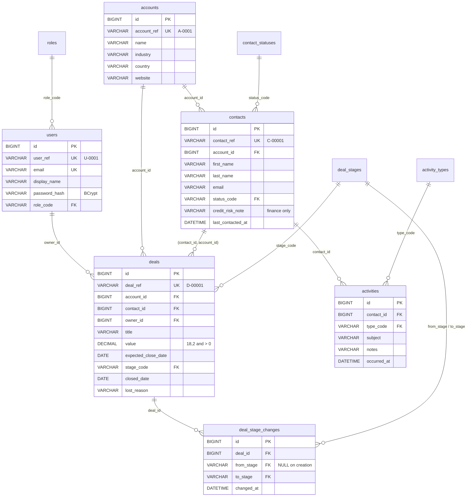

# The database

MySQL 8, database `nimbus_crm`. Two Flyway migrations own the schema:

- `src/main/resources/db/migration/V1__schema.sql` creates the tables, keys and constraints, and loads the lookup values.
- `V2__seed_data.sql` loads the demo data.

Hibernate never creates or alters a table (`ddl-auto: validate`). It only checks, at start-up, that the Java entities match what Flyway built.

## The tables at a glance



GitHub, VS Code (with a Mermaid extension) and most Markdown viewers draw this diagram. If yours doesn't, the same information is in the tables below.

| Table | Rows (seeded) | What one row is |
|---|---|---|
| `roles` | 2 | ADMIN or USER |
| `contact_statuses` | 3 | PROSPECT, CUSTOMER, CHURNED |
| `activity_types` | 4 | CALL, EMAIL, MEETING, NOTE |
| `deal_stages` | 6 | PROSPECTING … LOST, with `sort_order` and `is_open` |
| `users` | 3 | someone who can sign in |
| `accounts` | 30 | a company Nimbus sells to |
| `contacts` | 150 | a person at an account |
| `activities` | 224 | one call, email, meeting or note with a contact |
| `deals` | 32 | one sale being worked |
| `deal_stage_changes` | 103 | one move of one deal, oldest first |

## Keys

### Primary keys: a surrogate `id` on every table

Every entity table has `id BIGINT AUTO_INCREMENT PRIMARY KEY`. The database generates it, it never
changes, it carries no meaning, and every foreign key points at it.

The four lookup tables use their `code` as the primary key instead (`'NEGOTIATION'`, `'ADMIN'`).
The code is short, never changes, and is what the application already uses, so a separate number
would add nothing.

### Candidate keys: the business references

`account_ref`, `contact_ref`, `deal_ref` and `user_ref` are what people and the API use: "open
D-00016". Each has a `UNIQUE` constraint, so each one identifies a row as well as `id` does. That
makes it a **candidate key**. It is not the primary key, for two reasons:

- A reference is shown to people, so one day someone will ask to change its format. A primary key
  that is copied into every foreign key should never change.
- Joining on a `BIGINT` is cheaper than joining on a `VARCHAR`.

The API **only** accepts and returns references, never `id`. Exposing `id` would leak how many rows
there are and invite clients to guess them.

`users.email` is also `UNIQUE`: two people cannot sign in with the same address. `contacts.email` is
deliberately **not** unique, because sales teams share addresses like `info@` across people at one
account.

### Foreign keys, and what happens on delete

| Foreign key | References | On delete | Why |
|---|---|---|---|
| `contacts.account_id` | `accounts.id` | RESTRICT | An account with people at it cannot vanish by accident |
| `activities.contact_id` | `contacts.id` | CASCADE | A contact's history belongs to the contact |
| `deals.account_id` | `accounts.id` | RESTRICT | Never lose a deal because a company was tidied away |
| `deals.(contact_id, account_id)` | `contacts.(id, account_id)` | RESTRICT | See "The one deliberate redundancy" below |
| `deals.owner_id` | `users.id` | RESTRICT | Reassign a rep's deals before removing the rep |
| `deal_stage_changes.deal_id` | `deals.id` | CASCADE | Deleting a deal deletes its history |
| `users.role_code`, `contacts.status_code`, `activities.type_code`, `deals.stage_code`, `deal_stage_changes.from_stage`/`to_stage` | the lookup tables | (no action) | Only known values can be stored |

### Other constraints

- `CHECK (value > 0)` on `deals`. The API checks this too, but the database is the last line of defence.
- `NOT NULL` wherever a value is required: you cannot have a deal without a title, stage or owner.
- `DEFAULT 'PROSPECT'` and `DEFAULT 'PROSPECTING'` for a new contact's status and a new deal's stage.
- Indexes back the common queries: deals by `(expected_close_date, id)` for the paged list, by
  `(owner_id, stage_code)` for "my pipeline", contacts by `last_name` and `email`, and activities by
  `(contact_id, occurred_at)`. MySQL also indexes every foreign key automatically.

Try them. The database refuses each of these, whatever the application does:

```sql
UPDATE deals SET stage_code = 'NEGOTIATIONS' WHERE id = 1;  -- 1452: fk_deals_stage
UPDATE deals SET value = 0 WHERE id = 1;                    -- 3819: ck_deals_value_positive
UPDATE deals SET account_id = 1 WHERE id = 16;              -- 1452: fk_deals_contact_account (C-00001 works at A-0008)
DELETE FROM accounts WHERE id = 8;                          -- 1451: fk_contacts_account (it has contacts)
```

## Why the schema is shaped like this: normalisation

Normalisation means storing each fact **once**, in the one place it belongs, so it can never
disagree with itself. Here is how the three normal forms apply.

**First normal form (1NF): one value per column, and no repeating groups.** A contact's activities
are not a `calls` column holding "12/03 voicemail; 15/03 follow-up". Each one is a row in
`activities`. The same applies to deal history: one row per move in `deal_stage_changes`, not a
`history` text column on the deal.

**Second normal form (2NF): every non-key column depends on the whole key.** With single-column
surrogate keys, a partial dependency cannot happen. The stage history shows the idea: `changed_at`
describes one move, so it lives on the move's row and not on the deal.

**Third normal form (3NF): non-key columns depend on the key and nothing else.** The account name is
a fact about the account, so it lives in `accounts` only. A contact row holds `account_id`, never
`account_name`. The API puts the name next to the contact by **joining** when it reads. If a company
renames itself, that is one `UPDATE` on one row.

The same reasoning produced the **lookup tables**. A stage's order and whether it counts as "open"
are facts about the stage, not about each deal, so they live once in `deal_stages`. Before that
table existed, `stage` was free text, and nothing stopped one row holding `'Negotiation'` and
another `'NEGOTIATION '`. Now a foreign key makes any other value impossible.

### The one deliberate redundancy

`deals` holds both `contact_id` and `account_id`. Since a contact belongs to exactly one account,
`account_id` can be worked out from `contact_id`. That is a **transitive dependency**
(deal → contact → account), which 3NF says to remove.

It stays because "deals for this account" is a common question, and the deal list shows the
account on every row. Keeping the column means that query needs no join through `contacts`.

A redundant column is only dangerous if it can **disagree** with its source, and here it cannot:

```sql
-- in contacts
CONSTRAINT uq_contacts_id_account UNIQUE (id, account_id)
-- in deals
CONSTRAINT fk_deals_contact_account FOREIGN KEY (contact_id, account_id)
    REFERENCES contacts (id, account_id)
```

The composite foreign key says that the (contact, account) pair on a deal must be a pair that
exists in `contacts`. A deal can't name C-00001 with any account other than A-0008. The redundancy
buys speed, and the constraint takes away the risk. When you denormalise on purpose, this is how to
do it safely.

### Money and time

- `value` is `DECIMAL(18,2)`, never `FLOAT` or `DOUBLE`: 0.1 + 0.2 must equal 0.3 to the penny when
  the pipeline total is summed. In Java it is a `BigDecimal`. In JSON it is a plain number.
- Calendar dates (`expected_close_date`, `closed_date`) are `DATE`: a close date has no time of day
  and no time zone.
- Moments (`created_at`, `occurred_at`, `changed_at`) are `DATETIME(6)` in **UTC**. The API sends them
  as ISO-8601 with a `Z` suffix, and the browser converts them to local time for display.

## How a request reaches a table

```
GET /api/deals?stage=NEGOTIATION
  -> DealsController.list      parses and validates "NEGOTIATION"
  -> DealService.list          works out the owner scope from the JWT (null for ADMIN)
  -> DealRepository.search     JPQL: where stage = ? and (owner scope), order by expected_close_date, id
                               @EntityGraph joins account, contact and owner in the same SELECT
  -> DealResponse.from(...)    turns each entity into the JSON shape; ids stay behind
```

To see the SQL Hibernate runs, set `logging.level.org.hibernate.SQL: DEBUG` in `application.yml`.

## Exploring it yourself

Connect with any MySQL client (MySQL Workbench, DBeaver, the VS Code "SQLTools" extension) as `crm_app`. Some questions to answer with SQL:

```sql
-- Every foreign key in the schema, and what it points at
SELECT table_name, column_name, constraint_name, referenced_table_name, referenced_column_name
FROM information_schema.key_column_usage
WHERE table_schema = 'nimbus_crm' AND referenced_table_name IS NOT NULL
ORDER BY table_name;

-- The pipeline board, straight from the tables (compare with GET /api/deals/summary)
SELECT s.code, COUNT(d.id) AS deals, COALESCE(SUM(d.value), 0) AS total
FROM deal_stages s LEFT JOIN deals d ON d.stage_code = s.code
GROUP BY s.code, s.sort_order ORDER BY s.sort_order;

-- Each rep's open pipeline
SELECT u.display_name, COUNT(*) AS open_deals, SUM(d.value) AS open_value
FROM deals d JOIN users u ON u.id = d.owner_id JOIN deal_stages s ON s.code = d.stage_code
WHERE s.is_open GROUP BY u.display_name;
```

## Exercises

1. **Draw it.** Without looking at the diagram, sketch the tables and their foreign keys from
   `V1__schema.sql`. Mark each relationship one-to-many or many-to-one.
2. **Break it.** Write one `INSERT` or `UPDATE` that each constraint refuses, and record the error
   number MySQL gives. Which ones would the API have caught first, and which only the database?
3. **Who moved it?** The brief asks for "who moved the deal" in the history. Design the migration
   `V3__stage_change_actor.sql`: which column, which type, which foreign key, which `ON DELETE`, and
   what to put in the existing 103 rows. (Don't run it against the shared starter. Explain it.)
4. **Many currencies.** The brief also asks for deals in EUR and USD. Would you add a `currency`
   column to `deals`, a `currencies` lookup table, or both? Where would exchange rates live? Should
   the rate used when a deal is won be copied onto the deal, or looked up again each time? Argue
   for both, then choose.
5. **Check the boundary.** For every endpoint your screens use, compare the JSON it returns with the
   columns above. Does anything cross the API that should not, given who is allowed to see it?
