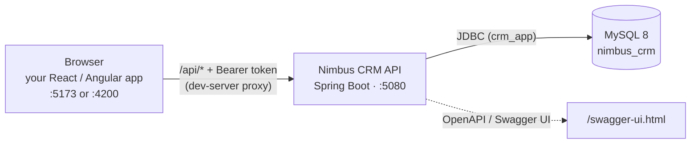
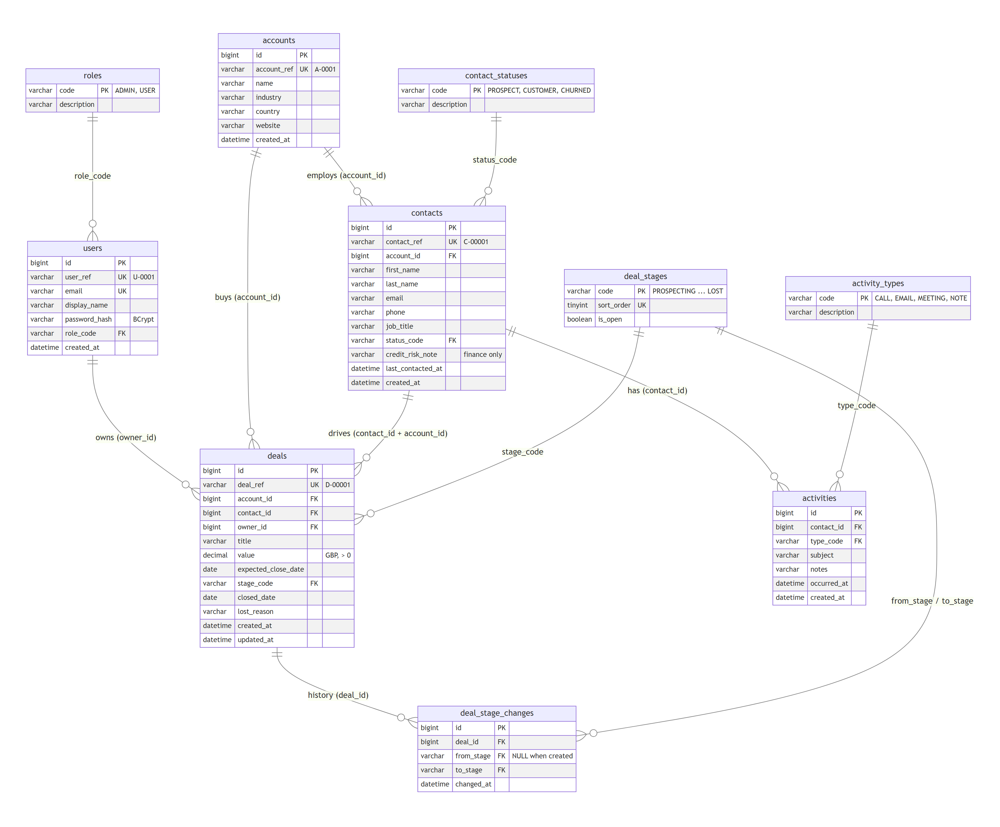

# Knowledge transfer: Nimbus CRM, backend → frontend

| | |
|---|---|
| **From** | CRM Platform team (backend) |
| **To** | Frontend team, Deals UI project |
| **Product owner** | Priya Raghavan, Head of Inside Sales |
| **Status** | Backend v1.0 released to the shared dev environment. The frontend starts now |
| **Read with** | [Stakeholder brief](stakeholder-brief.md) · [Backlog](backlog/README.md) · [Sprint plan](SPRINT-PLAN.md) · [Designs](designs/README.md) |

---

## 1. Why you are getting this

Inside Sales tracks its deals in a shared spreadsheet. In March a bad sort lost most of a quarter's forecast. Our team has built the backend for deals inside the CRM: the data, the rules, the security and the API. Nothing displays it yet.

Your team owns the user interface from here: React or Angular, your choice, in your own repository. This document is the handover. It tells you:

- what exists
- what the client asked for
- what we did not build
- how we expect to work with you

It does not tell you how to build the screens. That is your design.

## 2. People

| Who | Role | Talk to them about |
|---|---|---|
| Priya Raghavan | Product owner, Head of Inside Sales (ADMIN user) | Priorities, acceptance, anything the brief leaves unclear. She is in back-to-backs: batch your questions |
| Marcus Bell | Sales operations | How the pipeline stages work in practice |
| Anita Doshi | Sales rep | She reported CRM-142. A good person to test a contacts screen with |
| Aisha Khan, Ben Carter | Sales reps (USER) | Your day-to-day users |
| CRM Platform team | Owns the backend | API behaviour, defects, contract questions |

> In the capstone, your mentor plays the product owner and the backend team. Raise questions the way you would at work: in writing, specific, with evidence.

## 3. Scope: who owns what

| Area | Status | Owner |
|---|---|---|
| Database schema, seed data, migrations | Done | Backend |
| REST API (25 endpoints), validation, business rules | Done | Backend |
| Authentication (JWT) and authorisation (roles, deal ownership) | Done | Backend |
| OpenAPI document and Swagger UI | Done | Backend |
| API test suites (JUnit, end-to-end cross-check script) | Done | Backend |
| **Web UI: every screen, navigation, session handling, error display** | **Not started** | **Frontend (you)** |
| **UI tests (unit, component, end-to-end)** | **Not started** | **Frontend (you)** |
| Changes to the API | Not planned this release | Backend, on request with evidence |

## 4. System overview



There is one environment: everyone runs the API locally against their own MySQL. The steps are in the [README](../README.md) run book:

1. Create the database (once).
2. Start the API with `mvn spring-boot:run` in `backend/`.
3. Check it: Swagger UI loads, and `node scripts/crosscheck-backend.mjs` reports all checks passing.

**Point your dev server's proxy at `http://localhost:5080` for `/api`.** If you call the API directly instead, CORS allows `localhost:5173`, `5176` and `4200`.

## 5. Authentication and authorisation

- `POST /api/auth/login` with `{email, password}` returns `{token, expiresAt, user: {userRef, displayName, email, role}}`.
- Send `Authorization: Bearer <token>` on every other call. Tokens are HS256 JWTs and last **8 hours**. There is no refresh token: when a token expires, the API answers **401** and the user signs in again.
- `GET /api/auth/me` returns the current user, so you can restore a session after a page reload.

| Capability | ADMIN | USER (sales rep) |
|---|---|---|
| Read accounts, contacts, activities | ✔ | ✔ |
| Log an activity | ✔ | ✔ |
| See deals | all | **only deals they own** |
| Move a deal's stage | any deal | own deals |
| Create / edit / delete deals, choose owner | ✔ | ✘ 403 |
| Create / edit accounts and contacts, import CSV | ✔ | ✘ 403 |
| List users (`GET /api/users`) | ✔ | ✘ 403 |

**Ownership is enforced on the server.** A rep who asks for another rep's deal gets **404**, the same answer as for a deal that doesn't exist, so the API never confirms that a deal is there. Hiding a button in the UI is good UX. It is not security.

## 6. API contract

**The source of truth is the running OpenAPI document**: Swagger UI at `/swagger-ui.html`, and the JSON at `/v3/api-docs`. Every endpoint is also ready to send in [`backend/api-tests.http`](../backend/api-tests.http).

| Area | Endpoints |
|---|---|
| Auth | `POST /auth/login` · `GET /auth/me` · `GET /users` (ADMIN) |
| Accounts | `GET /accounts` · `GET /accounts/{ref}` · `GET /accounts/{ref}/contacts` · `POST /accounts` (ADMIN) · `PUT /accounts/{ref}` (ADMIN) |
| Contacts | `GET /contacts?page&size&status` · `GET /contacts/search?q` · `GET /contacts/{ref}` · `POST /contacts` (ADMIN) · `PUT /contacts/{ref}` (ADMIN) · `POST /contacts/import` (ADMIN, `text/csv`) |
| Activities | `GET /contacts/{ref}/activities` · `POST /contacts/{ref}/activities` |
| Deals | `GET /deals?page&size&stage` · `GET /deals/summary` · `GET /deals/{ref}` · `GET /deals/{ref}/history` · `GET /contacts/{ref}/deals` · `POST /deals/{ref}/stage` · `POST /deals` (ADMIN) · `PUT /deals/{ref}` (ADMIN) · `DELETE /deals/{ref}` (ADMIN) |

All paths are under `/api`. That is **25 endpoints** in total.

**Conventions**
- **Identifiers.** Records are addressed by business reference: `A-0008`, `C-00089`, `D-00016`, `U-0002`. Database ids never leave the API.
- **Paging.** Paged lists take `page` (0-based) and `size` (1–100, default 20). They return `{items, page, size, totalElements, totalPages}`.
- **Money.** `value` is a JSON number in GBP with two decimal places. `currency` is always `"GBP"`.
- **Dates and times.** Calendar dates are `yyyy-MM-dd`. Timestamps are ISO-8601 in UTC (`…Z`).
- **Enum values** are upper case:
  - stages: `PROSPECTING`, `QUALIFIED`, `PROPOSAL`, `NEGOTIATION`, `WON`, `LOST`
  - contact statuses: `PROSPECT`, `CUSTOMER`, `CHURNED`
  - activity types: `CALL`, `EMAIL`, `MEETING`, `NOTE`
- **Errors** come in two shapes:

```jsonc
// 400: one message per field, written to be shown to a user
{ "error": "VALIDATION_FAILED", "fields": { "value": "value must be greater than zero" } }
// 401, 403, 404, 409: a code to branch on, and a message to show
{ "error": "DEAL_STAGE_TRANSITION_INVALID", "message": "Cannot move D-00001 from PROSPECTING to NEGOTIATION. A deal moves forward one stage at a time." }
```

The error codes are:
- `UNAUTHENTICATED`
- `INVALID_CREDENTIALS`
- `FORBIDDEN`
- `ACCOUNT_NOT_FOUND`, `CONTACT_NOT_FOUND`, `DEAL_NOT_FOUND`
- `DEAL_STAGE_TRANSITION_INVALID`, `DEAL_CLOSED`, `DEAL_DELETE_NOT_ALLOWED`
- `VALIDATION_FAILED`
- `IMPORT_FORMAT_INVALID`

## 7. Data model

There are **10 tables and 60 columns**:
- six business tables;
- four lookup tables that fix the allowed values;
- 12 foreign keys linking them.

The full data dictionary, with the reasoning behind each key and constraint, is in [`backend/docs/DATABASE.md`](../backend/docs/DATABASE.md).



| Table | One row is | Notes for the UI |
|---|---|---|
| `users` | someone who can sign in | Role ADMIN or USER. Owns deals |
| `accounts` | a company we sell to | 30 seeded. There is no delete |
| `contacts` | a person at an account | 150 seeded. `email` is not unique. **`credit_risk_note` is finance-only: it must not be shown to sales staff or customers** |
| `activities` | a call, email, meeting or note | Logging one updates the contact's `last_contacted_at` |
| `deals` | a sale in progress | GBP value > 0. The contact must work at the deal's account. Has one owner |
| `deal_stage_changes` | one move of one deal | Written by the server. Read-only for you |
| `roles`, `contact_statuses`, `activity_types`, `deal_stages` | an allowed value | Your dropdowns must offer exactly these values |

## 8. Business rules the server enforces

1. A deal moves **one stage forward or one stage back** at a time. It can go to **LOST** from any open stage, and to **WON** only from **NEGOTIATION**. **WON** and **LOST** are final.
2. Winning a deal needs a `closeDate`. Losing one needs a `lostReason`.
3. Winning a deal makes its contact a **CUSTOMER**. Losing a deal never reverses that.
4. A new deal starts in **PROSPECTING**. Its `expectedCloseDate` can't be in the past, and its contact must work at its account.
5. Only a **PROSPECTING** deal can be deleted. A WON or LOST deal can't be edited.
6. Every stage change is recorded with the from-stage, the to-stage and the time.
7. `GET /deals/summary` gives the count and value per stage and the **open** total (the four open stages). It is scoped to the caller: a rep sees their own figures.

Breaking a rule returns 400 or 409 with a message written for the end user. Show it. Don't rewrite it.

## 9. Not in this release

The brief asks for these, and the backend **does not support** them. Don't build workarounds without the product owner's agreement:

| Asked for | Status |
|---|---|
| "Who moved it" in the stage history | Not recorded. The history has the time and the stages only |
| Amounts in each deal's own currency | Not supported. GBP only |
| A board that updates in real time | Not supported. The API is plain request and response |
| Deleting accounts or contacts | No endpoint, by design |

## 10. Test data

| Sign in as | Password | Role | Sees |
|---|---|---|---|
| `admin@nimbus.test` (Priya) | `Admin#2026` | ADMIN | all 32 deals |
| `aisha@nimbus.test` | `Rep#2026` | USER | her 16 deals |
| `ben@nimbus.test` | `Rep#2026` | USER | his 16 deals |

`db-setup/02-reset-schema.mysql.sql`, followed by an API restart, puts the data back to this state. These are local development credentials only.

## 11. How we work together

- **Backlog:** [`docs/backlog/`](backlog/README.md). Every piece of work is a ticket (`NIM-1xx`) with acceptance criteria. Pick up tickets in the order of the [sprint plan](SPRINT-PLAN.md).
- **Designs:** [`docs/designs/`](designs/README.md) shows the **design intent** for the main screens. It isn't pixel-perfect. Any state not shown (loading, empty, errors, the rep's view) is for you to design.
- **Specification first:** NIM-100 (the spec, using `docs/specs/_template.md`) is done before any screen ticket starts.
- **Branches and PRs:**
  - Work on one branch per ticket (`feature/NIM-112-contact-profile`).
  - Open one pull request per ticket, with the ticket ID in the title.
  - Show the acceptance criteria and the evidence that each one is met (screenshots, test names).
- **AI assistants (GitHub Copilot) are expected.**
  - You own every line you merge.
  - Keep a short **prompt journal** per ticket: what you asked, what you kept, and what you changed and why.
  - Never paste tokens, passwords or customer data into a prompt.
- **Backend defects:** if the API looks wrong, raise a bug with the request, the response, what you expected and why, and the impact. Use the guide in [`backend/docs/API-TESTING.md`](../backend/docs/API-TESTING.md). Don't work around it silently, and don't edit the backend.
- **Definition of done** (per ticket):
  - The acceptance criteria are met for each role that can see the feature.
  - The loading, empty and error states exist.
  - Automated tests cover the acceptance criteria.
  - It works with the keyboard alone.
  - No secrets or restricted data appear in the UI, the console or URLs.
  - The PR has been reviewed against [`docs/review-checklist.md`](review-checklist.md).

## 12. Known open items from the backend team

- **CRM-142**: Inside Sales report that the contact list is out of order. It has been closed twice as "cannot reproduce". Ticket NIM-114 asks you to investigate it from the UI side. The report is in [`bug-CRM-142.md`](bug-CRM-142.md).
- The stage rules in section 8 come from Marcus. The brief doesn't list them. Confirm the user-facing wording with Priya.
- We have tested the API with our scripts, not with a real UI. Expect to find things. When you do, tell us.
