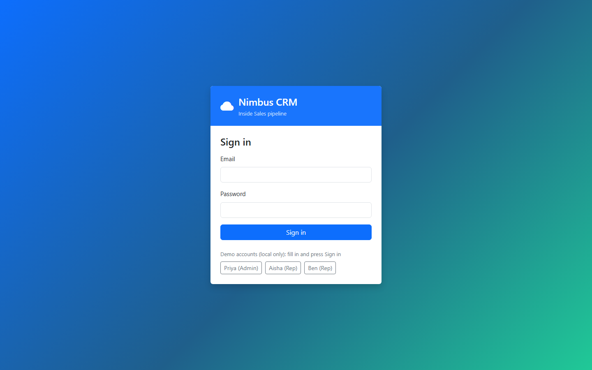

# NIM-102 · Sign in

| | |
|---|---|
| **Type** | Story |
| **Epic** | Access & identity |
| **Sprint** | Sprint 1 |
| **Priority** | Highest |
| **Story points** | 3 |
| **Depends on** | [NIM-101](NIM-101-project-setup.md) |

## User story

> As a member of the Inside Sales team, I want to sign in with my work email and password, so that only Nimbus staff can see customer data.

## Context

Every API call except sign-in now requires a token. Until the user signs in, the app can show nothing else.

## Acceptance criteria

```gherkin
Scenario: Successful sign-in
  Given I am signed out
  When I sign in as aisha@nimbus.test with the correct password
  Then I land on the page I originally asked for, or the home page if I asked for none

Scenario: Wrong credentials
  When I sign in with a wrong password
  Then I am told the email or password is incorrect, without being told which
  And the email I typed is kept and the password is cleared

Scenario: Missing input
  When I submit with the email or password empty
  Then I am told which field is missing, and no request is sent

Scenario: Unsafe return address
  Given I followed a sign-in link whose return address points to another website
  When I sign in
  Then I land on the home page of this app
```

## Design

Design intent (not a pixel spec; states not shown are yours to design):



## Backend notes

`POST /api/auth/login` → `{token, expiresAt, user}`. Wrong credentials → 401 `INVALID_CREDENTIALS`. Empty body → 400 with `fields.email` / `fields.password`.

## Out of scope

Password reset, "remember me", self sign-up.
