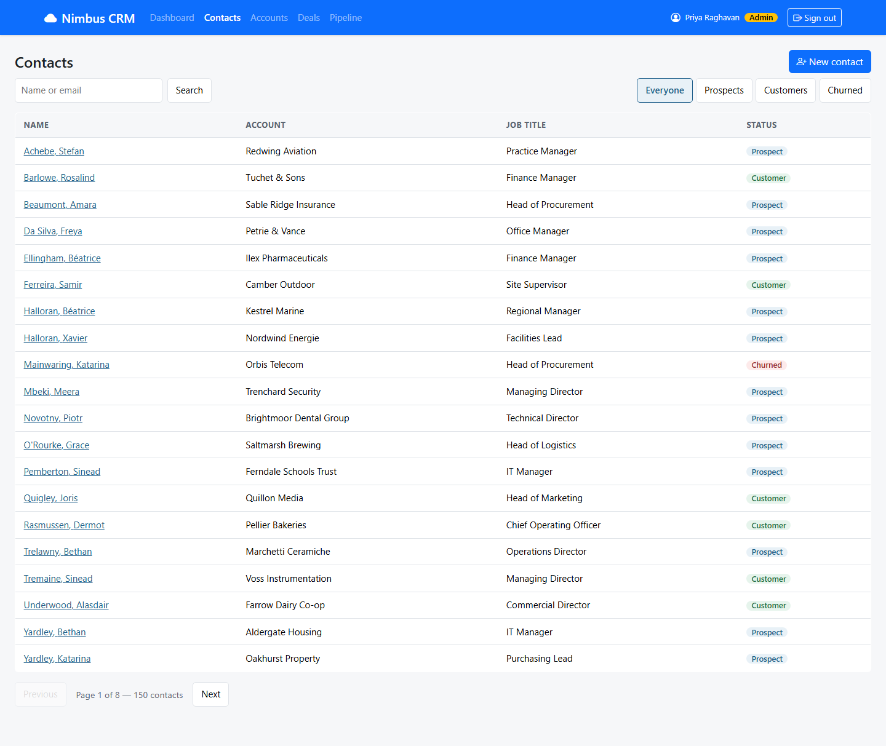

# NIM-110 · Contact list

| | |
|---|---|
| **Type** | Story |
| **Epic** | Customers (contacts & accounts) |
| **Sprint** | Sprint 1 |
| **Priority** | High |
| **Story points** | 3 |
| **Depends on** | [NIM-104](NIM-104-role-aware-access.md) |

## User story

> As a rep, I want to browse contacts in surname order, a page at a time, and filter them by status, so that I can work through the people we sell to.

## Context

This screen replaces the contacts tab of the old spreadsheet. Inside Sales expect surname order.

## Acceptance criteria

```gherkin
Scenario: Browse
  Given I am signed in
  When I open the contacts list
  Then I see 20 contacts per page with name, account, job title and status
  And I can move to the next and previous pages and see which page I am on out of how many

Scenario: Filter by status
  When I filter by Customer
  Then only customers are listed, and paging applies to the filtered list

Scenario: Open a contact
  When I choose a contact
  Then I see their profile (NIM-112)

Scenario: Nothing to show
  When a filter matches nobody
  Then I am told so
```

## Design

Design intent (not a pixel spec; states not shown are yours to design):



## Backend notes

`GET /api/contacts?page=&size=&status=` (status: `PROSPECT`, `CUSTOMER`, `CHURNED`).

## Notes

See NIM-114 before you sign this off.
