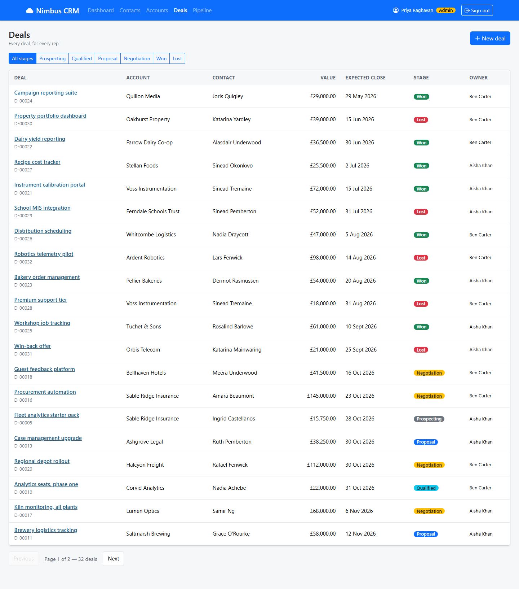

# NIM-120 · Deal list

| | |
|---|---|
| **Type** | Story |
| **Epic** | Deal pipeline |
| **Sprint** | Sprint 2 |
| **Priority** | Highest |
| **Story points** | 5 |
| **Depends on** | [NIM-104](NIM-104-role-aware-access.md) |

## User story

> As a rep, I want to see my deals, soonest closing first, and filter them by stage, so that the spreadsheet is no longer needed.

## Context

Priya: "I want to open the CRM and see our deals, the same way I can see our contacts." Reps see their own deals; Priya sees everyone's.

## Acceptance criteria

```gherkin
Scenario: My deals
  Given I am signed in as aisha@nimbus.test
  When I open deals
  Then I see only deals I own: 16 on a freshly seeded database
  And each shows title, account, contact, value in pounds, expected close date, stage and owner

Scenario: Everyone's deals
  Given I am signed in as Priya
  Then I see all 32 deals

Scenario: Filter and page
  When I filter by Negotiation
  Then only deals in Negotiation are listed
  And the filter and page survive a browser reload and can be shared as a link

Scenario: Open a deal
  When I choose a deal
  Then I see its details (NIM-121)
```

## Design

Design intent (not a pixel spec; states not shown are yours to design):



## Backend notes

`GET /api/deals?page=&size=&stage=`. An unknown stage → 400 with `fields.stage`.
