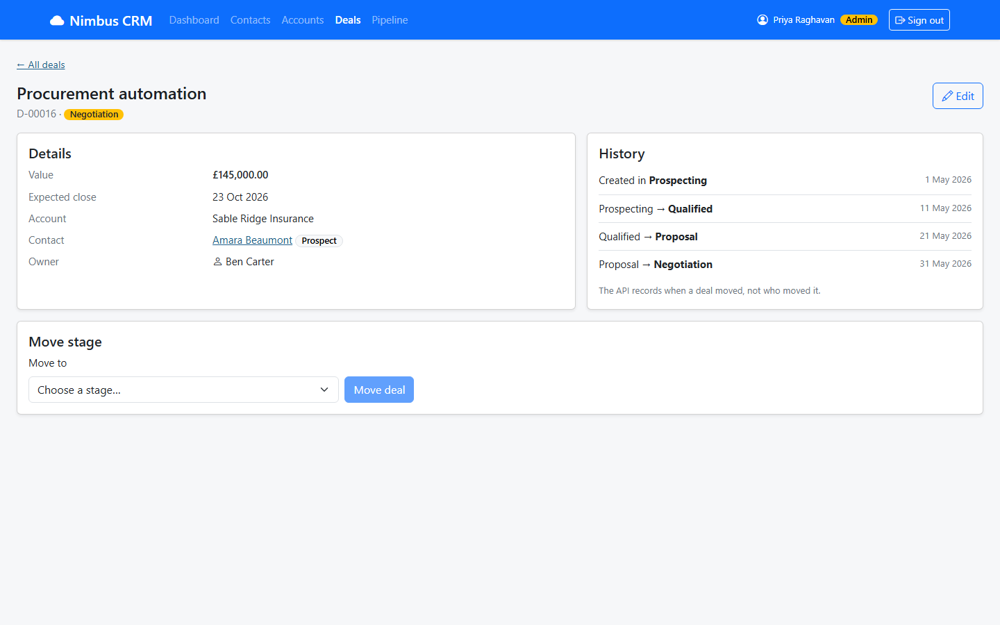

# NIM-122 · Move a deal through the pipeline

| | |
|---|---|
| **Type** | Story |
| **Epic** | Deal pipeline |
| **Sprint** | Sprint 2 |
| **Priority** | Highest |
| **Story points** | 5 |
| **Depends on** | [NIM-121](NIM-121-deal-details.md) |

## User story

> As a rep, I want to move my deal to its next stage, or back, or close it, so that the pipeline is accurate.

## Context

Priya: "It should not be possible to put a deal in a silly state. Deals do go backwards sometimes… but obviously not just anything to anything. When a deal is won I want that reflected on the customer record."

## Acceptance criteria

```gherkin
Scenario: Allowed moves only
  Given a deal in an open stage
  Then I am only offered the moves the business allows

Scenario: Winning and losing
  When I win a deal, I must give the close date
  When I lose a deal, I must give a reason
  And a closed deal (Won or Lost) cannot be moved again

Scenario: Effect on the customer
  When I win a deal for a prospect
  Then that contact is shown as a customer everywhere in the app

Scenario: Refused by the server
  When the server refuses a move
  Then I see its explanation and the deal is unchanged
```

## Design

Design intent (not a pixel spec; states not shown are yours to design):



## Backend notes

`POST /api/deals/{ref}/stage` with `{stage, closeDate?, lostReason?}`. Refusals → 409 `DEAL_STAGE_TRANSITION_INVALID` or 400 with fields. Rules: KT handover, section 8.

## Notes

The brief does not list the stages or the rules. Confirm them before building (NIM-100).
