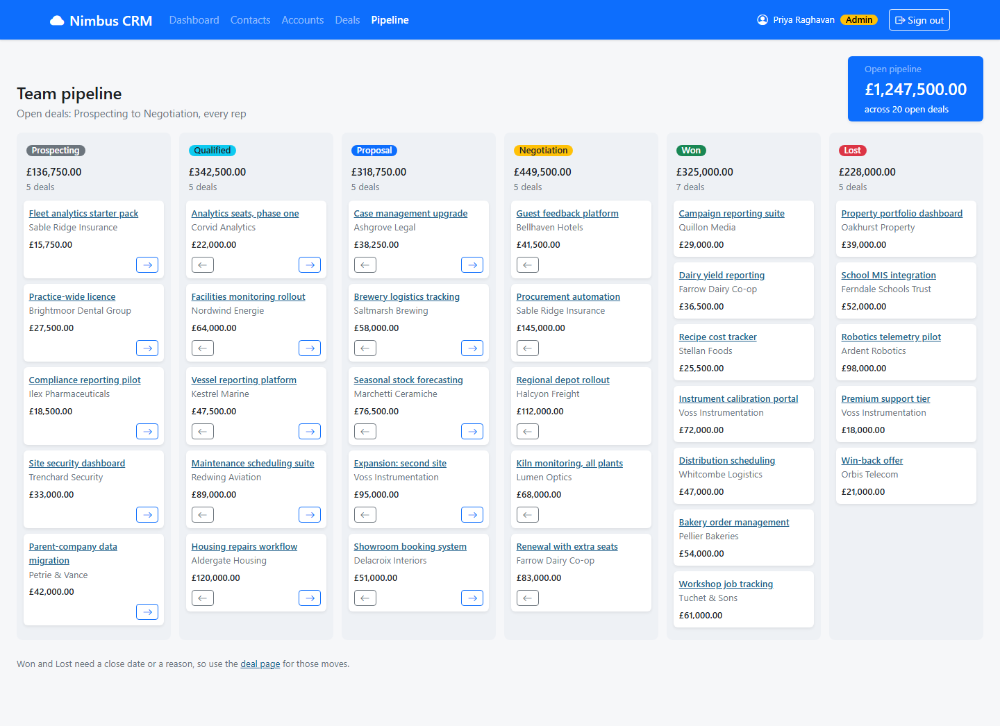

# NIM-123 · Pipeline board and the Monday number

| | |
|---|---|
| **Type** | Story |
| **Epic** | Deal pipeline |
| **Sprint** | Sprint 2 |
| **Priority** | Highest |
| **Story points** | 5 |
| **Depends on** | [NIM-120](NIM-120-deal-list.md) |

## User story

> As the Head of Inside Sales, I want to see what the pipeline is worth, broken down by stage, so that I have my number for the Monday call without working it out by hand.

## Context

Priya: "I need to see the total value of the pipeline at any moment, broken down by stage. This is the number I take into the Monday leadership call… If I only get one thing from this project, this is it. Ideally the board updates in real time."

## Acceptance criteria

```gherkin
Scenario: The board
  When I open the pipeline
  Then I see every stage in pipeline order with the number of deals and their total value
  And I see the pipeline total Priya asked for

Scenario: Numbers match the system of record
  Then every figure equals what the API reports, to the penny
  And on a freshly seeded database, Priya's figures agree with the KT handover's test data

Scenario: Each person's board
  Given I am signed in as a rep
  Then the board shows my pipeline only
```

## Design

Design intent (not a pixel spec; states not shown are yours to design):



## Backend notes

`GET /api/deals/summary` (count and value per stage plus open totals, scoped to the caller), `GET /api/deals?stage=`.

## Notes

"The total value of the pipeline" is not defined precisely in the brief. Agree the definition with Priya and record it in the spec.
