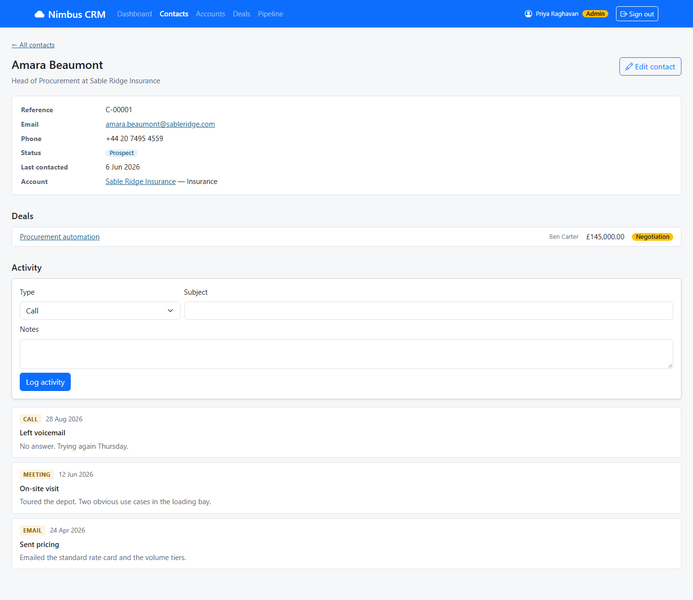

# NIM-124 · Deals and activity on the contact page

| | |
|---|---|
| **Type** | Story |
| **Epic** | Deal pipeline |
| **Sprint** | Sprint 2 |
| **Priority** | High |
| **Story points** | 3 |
| **Depends on** | [NIM-112](NIM-112-contact-profile.md), [NIM-120](NIM-120-deal-list.md) |

## User story

> As a rep, I want to see a contact's deals and log a call or email on their page, so that I see the whole relationship and keep the history complete without leaving it.

## Context

Priya: "There is usually one person there who is actually driving it, so I should be able to see the deal from their record too."

## Acceptance criteria

```gherkin
Scenario: Deals on the contact
  When I open a contact
  Then I see the deals they are driving that I am allowed to see, with stage and value, each leading to the deal

Scenario: Log an activity
  When I log a call with a subject and notes
  Then it appears at the top of their history straight away
  And the contact's "last contacted" date reflects it

Scenario: Invalid activity
  When I try to log an activity without a subject
  Then I am told what is missing
```

## Design

Design intent (not a pixel spec; states not shown are yours to design):



## Backend notes

`GET /api/contacts/{ref}/deals`, `POST /api/contacts/{ref}/activities` with `{type, subject, notes?, occurredAt?}`.
