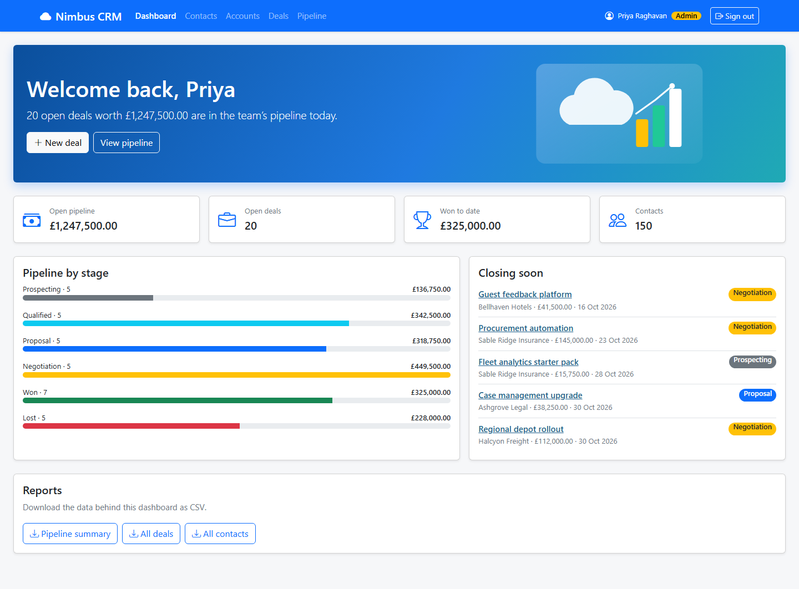

# NIM-125 · Home page

| | |
|---|---|
| **Type** | Story |
| **Epic** | Deal pipeline |
| **Sprint** | Sprint 2 |
| **Priority** | Medium |
| **Story points** | 3 |
| **Depends on** | [NIM-123](NIM-123-pipeline-board.md) |

## User story

> As anyone in Inside Sales, I want a home page that tells me how we are doing when I sign in, so that I know where to focus today.

## Context

Raised by Priya in passing: "Can the first page just tell me how we're doing?" No metrics were specified.

## Acceptance criteria

```gherkin
Scenario: Agreed content
  Given the team has agreed with Priya which figures and lists the home page shows
  When I sign in
  Then I see those figures, scoped to what my role allows
  And every figure matches the screens it summarises
```

## Design

Design intent (not a pixel spec; states not shown are yours to design):



## Notes

The design shows one possibility. Content must be agreed with the product owner before it is built.
