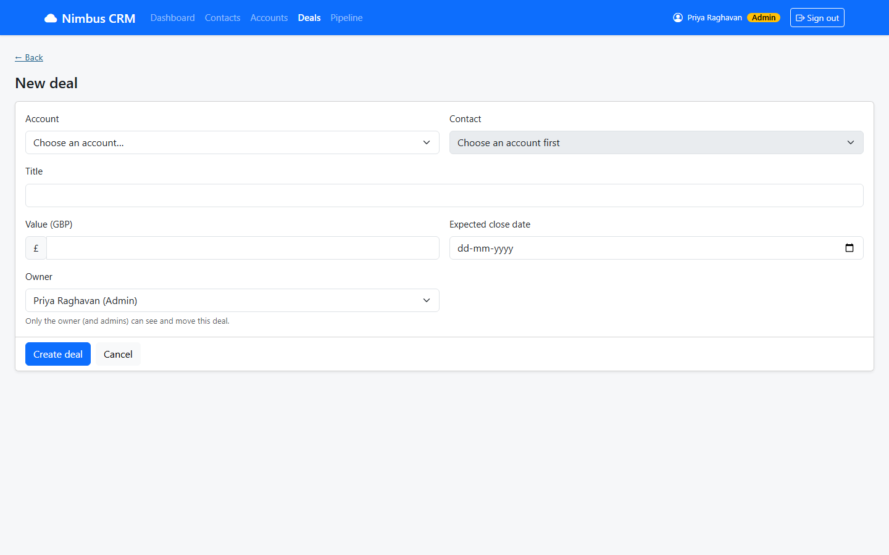

# NIM-131 · Assign a deal owner

| | |
|---|---|
| **Type** | Story |
| **Epic** | Data management (admin) |
| **Sprint** | Sprint 3 |
| **Priority** | High |
| **Story points** | 2 |
| **Depends on** | [NIM-130](NIM-130-manage-deals.md) |

## User story

> As Priya, I want to choose which rep owns a deal and change it later, so that work is shared out and every deal has someone responsible.

## Context

Ownership decides who can see and move a deal.

## Acceptance criteria

```gherkin
Scenario: Choose owner
  When I create or edit a deal
  Then I can choose its owner from the people who can sign in

Scenario: Effect of ownership
  Given I create a deal owned by Ben
  When Ben signs in
  Then he can see and move it
  And Aisha cannot see it
```

## Design

Design intent (not a pixel spec; states not shown are yours to design):



## Backend notes

`GET /api/users` (ADMIN). `ownerRef` on create and update. Unknown owner → 400 `fields.ownerRef`.
