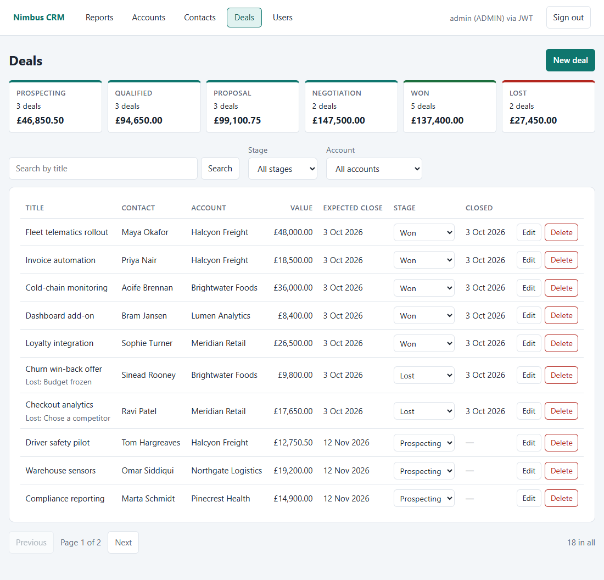
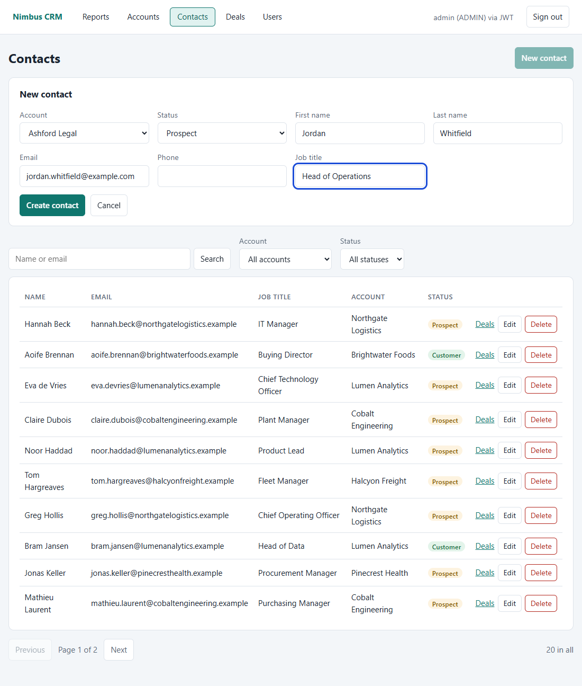
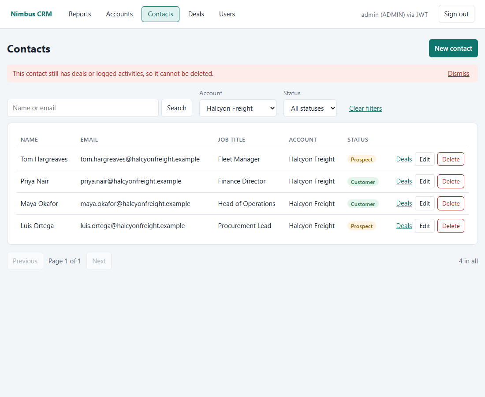

# Screenshots of the two full-stack CRMs

The same React frontend, with the same sample data, against each backend: **.NET 10 + MySQL** (folder [dotnet](dotnet)) and
**Java Spring Boot + MySQL** (folder [java](java)). Taken 2026-10-14. The numbers match because both backends implement
one API contract. Nothing in these pictures is a mock: they were taken from the running apps.

Where the two folders differ: `23` and `24` are the API documentation page. The .NET API serves its own docs page (Scalar);
the Java API serves only its OpenAPI document, so its picture shows that document in the same viewer (`23` only).

| # | File | What it shows |
|---|---|---|
| 01 | `01-sign-in` | Sign-in with the three methods (JWT, cookie, session) |
| 02 | `02-sign-in-wrong-password` | The generic wrong-password message |
| 03 | `03-register-validation` | Register: each server message beside its own field |
| 04 | `04-reports-admin` | Reports as ADMIN: four reports, each with a Download CSV button |
| 05 | `05-users-admin` | Users list (ADMIN only) |
| 06 | `06-reports-user` | The same page for a USER: three reports |
| 07 | `07-no-access` | A USER opening an admin page |
| 08 | `08-session-ended` | A signed-out credential: back to sign-in with the reason |
| 09 | `09-reports-phone-dark` | Reports on a phone, dark scheme |
| 01 | `01-accounts-list` | Accounts: search, paging, contact counts, Edit and Delete |
| 02 | `02-new-account-field-errors` | New account: server messages beside the right inputs |
| 03 | `03-contacts-filtered` | Contacts filtered by account and status |
| 04 | `04-deals-pipeline` | Deals: pipeline summary and the list with stage controls |
| 05 | `05-deal-edit-lost-reason` | Edit deal: Lost needs a reason |
| 06 | `06-blocked-delete-message` | Deleting an account that has contacts is refused, with the reason |
| 07 | `07-user-no-delete-buttons` | A USER sees no Delete buttons |
| 08 | `08-deals-phone-dark` | Deals on a phone, dark scheme |
| 10 | `10-account-edit-form` | Edit account |
| 11 | `11-contacts-list` | Contacts, unfiltered |
| 12 | `12-contact-new-form` | New contact, filled in |
| 13 | `13-contact-edit-form` | Edit contact |
| 14 | `14-contact-blocked-delete` | Deleting a contact that has deals is refused, with the reason |
| 15 | `15-deal-new-form` | New deal, filled in |
| 16 | `16-deal-lost-reason-dialog` | Changing a deal's stage to Lost asks for the reason |
| 17 | `17-deal-delete-confirm` | Delete confirmation |
| 18 | `18-accounts-user-no-delete` | Accounts as a USER: no Delete buttons |
| 19 | `19-contacts-user-no-delete` | Contacts as a USER: no Delete buttons |
| 20 | `20-accounts-phone` | Accounts on a phone (rows become cards) |
| 21 | `21-contacts-phone` | Contacts on a phone |
| 22 | `22-contact-form-phone` | New contact form on a phone |
| 23 | `23-api-docs-endpoints` | The API documentation page with every endpoint |
| 24 | `24-api-docs-create-deal` | One operation in detail (.NET only) |

(The first nine rows come from `npm run screenshots`, the next eight from `npm run screenshots:crm`, and 10 to 22 from
`npm run screenshots:more`; see [../README.md](../README.md).)

## Highlights

| .NET backend | Java backend |
|---|---|
|  |  |
|  |  |
|  |  |
